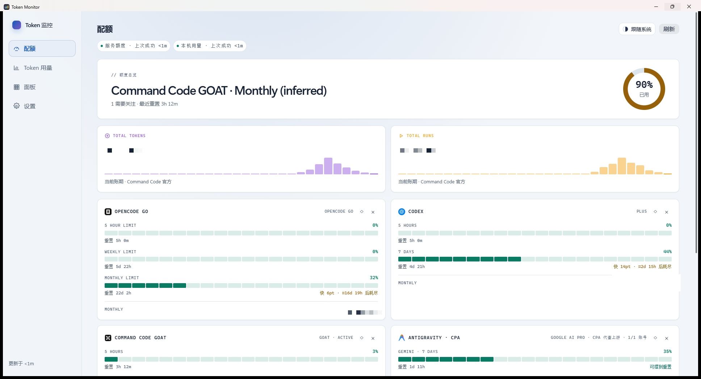

<div align="center">

# tui-token-monitor

Subscription quota, token ledger, burn rate and heatmaps for AI coding CLIs — in your terminal or on your Windows desktop. Local-first; no relay server involved.



[](https://github.com/jryang1997/tui-token-monitor/actions/workflows/ci.yml)
[](LICENSE)


</div>

> 中文文档见 [README.md](README.md)。

## What it does

For heavy users of AI coding CLIs (Claude Code, Codex, OpenCode, z.ai GLM, Kimi, DeepSeek…): quotas are pulled directly from each provider's official/login-state endpoints, the token ledger reads local session files, and USD pricing uses LiteLLM's public price list (7-day cache). Everything stays on your machine — no telemetry, no upload.

A single-binary Rust TUI (ratatui) plus a Windows desktop shell (WebView2):

- **Quota page** — one card per subscription: 5h / weekly / monthly windows with █░ progress bars and pace-based exhaustion estimates; system toast notifications on 80% / 100% / reset crossings (deduplicated, optional night silence).
- **Usage page** — last 60 minutes, today / ISO-week / month totals, agent / session / project / model breakdowns, stacked 24h / 14d trends, monthly API-equivalent cost vs. plan price benchmark, CSV / JSON export.
- **Heatmap page** — 26-week GitHub-style contribution grid + work-hours profile.
- Bilingual (zh/en, `l`), four themes (`p`), 60s auto-refresh. Quota sources fail independently; the ledger is fully offline-capable.

## Data sources

### Quota (six cards, collected independently)

| Card | Path | Credentials |
|---|---|---|
| OpenCode Go | official usage API | Windows Credential Manager / `OPENCODE_GO_API_KEY` / OpenCode login |
| Codex | official `app-server` (fallback: wham endpoint → OMP) | Codex CLI login (`CODEX_HOME` honored) |
| Command Code GOAT | billing API | Credential Manager / `COMMAND_CODE_API_KEY` / `cmdc login` |
| Antigravity | Google upstream via [CPA](https://github.com/luispater/CLIProxyAPI) | `~/.tui-token-monitor/cpa-key` |
| Claude Pro/Max | official `oauth/usage` endpoint | Claude Code login (`~/.claude/.credentials.json`) |
| Cursor | usage-summary (undocumented endpoint) | Cursor login (state.vscdb / `cursor-agent login`) |

Cards with a billing cycle (GOAT / Codex / Cursor) show their **subscription end date** and fire tiered system reminders 7/3/1 days before expiry (deduplicated; silent after renewal). See the [subscription-period research notes](docs/research/subscription-period-sources.md).

### Token ledger (six sources, purely local)

Codex sessions, OMP stats.db, OpenCode db, ZCode db, DeepSeek Harness zstd sessions, Claude Code transcripts — see the Chinese README for the path table.

> **Unofficial endpoints**: Codex wham, GOAT `/alpha/billing`, and Google `retrieveUserQuotaSummary` are undocumented internal APIs with no stability guarantee. Failures degrade to a Missing card only. Primary-source research notes live in [docs/research/](docs/research/).

Outbound requests honor `HTTP_PROXY` / `HTTPS_PROXY` / `ALL_PROXY`.

## Install

### TUI

Requires Rust 1.85+ (edition 2024).

```sh
cargo install --path .    # or cargo build --release
```

### Windows GUI

```sh
cd gui/frontend && npm ci && npm run build && cd ../..
cargo build --release --manifest-path gui/Cargo.toml
run_gui.bat
```

Needs the WebView2 Runtime (preinstalled on Win10/11). Frontend assets are embedded into the binary via `include_dir!`.

## Platform support

| | TUI | Desktop GUI |
|---|---|---|
| Windows | ✅ first-class (MSVC & GNU both CI-verified) | ✅ WebView2 |
| macOS / Linux | ✅ builds + full ledger; quota cards limited to env-var/CLI-login credentials, no system toast | ❌ |

## Privacy

All data stays local. No telemetry. API keys go only to the Windows Credential Manager. The app never mutates CLI-owned state (login files are read-only; OAuth tokens are never refreshed on your behalf).

## Verification

```sh
cargo test                                   # 113 tests: fixture replay, in-memory SQLite, multi-frame zstd, headless rendering
cargo test --manifest-path gui/Cargo.toml    # 11 GUI shell tests
cargo run --example ledger_smoke
```

## License

[MIT](LICENSE)
